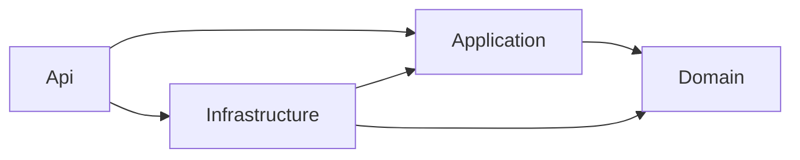
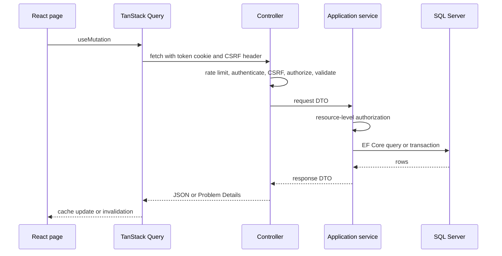

# Architecture

## Dependency direction



| Project | Responsibility |
| --- | --- |
| `Domain` | Scaffolded entities, byte enums, role and permission constants |
| `Application` | Business rules, services, DTOs, validators, pagination, rich text, abstractions |
| `Infrastructure` | EF Core context, password hashing, field encryption, object storage, seeding |
| `Api` | HTTP, JWT cookie auth, CSRF, rate limiting, error handling, SignalR, hosting |
| `tools/DbMigrator` | EF Core bundle that applies the SQL scripts on a server |

`Application` talks to data through `IAppDbContext`, implemented by a partial class of the scaffolded
context. This gives testable boundaries without a generic repository over EF Core.

## Request flow



## Frontend

```
app/          providers, router, guards, layouts
components/   ui, forms, feedback, navigation, brand, common
features/     auth, clubs, feed, posts, comments, files, announcements, events,
              profile, moderation, administration, notifications, search, pwa
services/     API client, query client, live updates
hooks/ lib/ styles/ types/
```

- Server data lives only in TanStack Query. Context holds the theme, toasts and signed-in user.
- Filters and pages live in the URL.
- Voting, bookmarking and joining update optimistically, then reconcile with the server.
- Routes other than the landing page, sign-in and the feed are loaded on demand, as is the editor.
- Navigation and actions follow the permissions returned for the signed-in user.

## Real-time updates

SignalR (`/hubs/live`) sends two signals: `NotificationsChanged` to a user and `CommentsChanged` to
viewers of a post. Signals carry no content; the client re-reads through the authorized REST API.
They are queued during a request and sent only after the action succeeds. The app keeps working if
the connection is unavailable.

## Error handling

Services throw typed exceptions. `GlobalExceptionHandler` converts them to Problem Details with 400,
401, 403, 404, 409 or 503. Unexpected errors return 500 with details only in Development.
Field errors use an `errors` object that forms map back to inputs.

## Roles and permissions

Permission keys live in `Domain/Constants/Permissions.cs` and role grants in `RolePermissions`.
Each key is an authorization policy; services also check the specific resource (membership,
authorship, assigned club). Administrators always hold every permission. Students start with the
participation permissions; moderators add the moderation permissions, which apply only in assigned
clubs. Changes take effect on the next request.

## Recommendations

A transparent weighted score, with no external service: chosen interests, categories of joined clubs,
clubs and tags the member upvoted, discussions they commented in, and a penalty for downvotes. It
ranks suggested clubs (with the main reason) and the "For you" feed.

## Rich text, mentions and tags

The editor sends HTML. The server sanitises it, links `@username` and `#tag`, stores tags in
`PostTags` and `CommentTags`, and notifies newly mentioned users.

## Security

| Concern | Measure |
| --- | --- |
| Passwords | ASP.NET Core Identity hasher; lockout after 5 failures; forced change of temporary passwords |
| Session | Signed JWT in an HttpOnly, SameSite=Strict cookie; Secure outside Development; re-validated per request |
| CSRF | Antiforgery token header required on every state-changing `/api` request |
| Authorization | Fallback policy requires sign-in; permission policies; per-club and per-file checks |
| In transit | HTTPS required in production, HSTS |
| At rest | AES-256-GCM on post, comment and announcement bodies, bios, request justifications and notification text |
| Input | HTML sanitiser, FluentValidation, database constraints, parameterised EF queries |
| Files | Extension, MIME and signature checks, size and quota limits, random keys, private bucket |
| Abuse | Overall and sensitive-action rate limits |
| Headers | CSP in production, `nosniff`, framing restricted to the app's own file previews |

### Why not end-to-end encryption

The server must read content to moderate it, search it, link mentions and recommend clubs. Content is
therefore encrypted in transit and in the database, with the key held by the server. Titles, names,
emails and tags are not encrypted so that they stay searchable. Files are not encrypted by the
application; rely on the storage service's own encryption.
