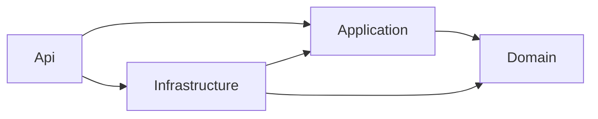
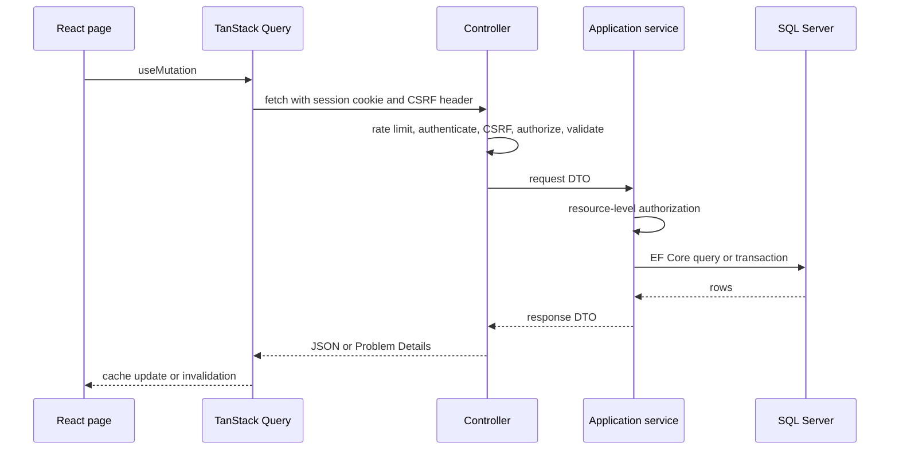

# Architecture

## Dependency direction



| Project | Responsibility |
| --- | --- |
| `Domain` | Scaffolded entities, byte enums, role constants |
| `Application` | Business rules, services, DTOs, validators, pagination, abstractions |
| `Infrastructure` | EF Core context, password hashing, object storage, seeding |
| `Api` | HTTP, cookie auth, CSRF, rate limiting, error handling, SignalR, hosting |

`Application` talks to data through `IAppDbContext`, implemented by a partial class of the scaffolded
context. This gives testable boundaries without a generic repository over EF Core.

## Request flow



## Frontend

```
app/          providers, router, guards, layouts
components/   ui, forms, feedback, navigation, brand, common
features/     auth, clubs, feed, posts, comments, files, announcements, events,
              profile, moderation, administration, notifications, search, pwa
services/     API client, query client, live updates
hooks/ lib/ styles/ types/
```

- Server data lives only in TanStack Query. Context holds the theme, toasts and signed-in user.
- Filters and pages live in the URL.
- Voting, bookmarking and joining update optimistically, then reconcile with the server.
- Routes other than sign-in and the feed are loaded on demand.

## Real-time updates

SignalR (`/hubs/live`) sends two signals: `NotificationsChanged` to a user and `CommentsChanged` to
viewers of a post. Signals carry no content; the client re-reads through the authorized REST API.
They are queued during a request and sent only after the action succeeds. The app keeps working if
the connection is unavailable.

## Error handling

Services throw typed exceptions. `GlobalExceptionHandler` converts them to Problem Details with 400,
401, 403, 404, 409 or 503. Unexpected errors return 500 with details only in Development.
Field errors use an `errors` object that forms map back to inputs.

## Security

| Concern | Measure |
| --- | --- |
| Passwords | ASP.NET Core Identity hasher; lockout after 5 failures |
| Session | HttpOnly, SameSite=Strict cookie; Secure outside Development; re-validated per request |
| CSRF | Antiforgery token header required on every state-changing `/api` request |
| Authorization | Fallback policy requires sign-in; role policies; per-club and per-file checks in services |
| Input | FluentValidation, database constraints, parameterised EF queries |
| Output | React escaping; only `http`/`https` links become anchors with `noopener` |
| Files | Extension, MIME and signature checks, size and quota limits, random keys |
| Abuse | Rate limits on sign-in, registration, password change, uploads and club requests |
| Headers | CSP and HSTS in production, `nosniff`, frame denial |
