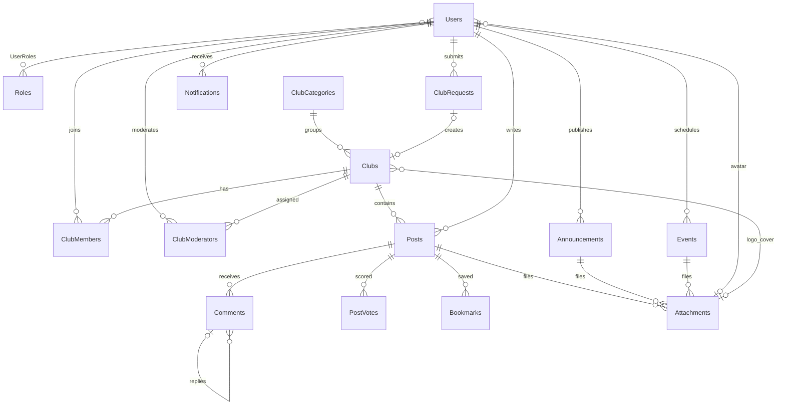

# Database

## Database First

The SQL scripts in `database/` define the schema. EF Core entities and `CampusConnectDbContext` are
generated from the live database. There are no migrations and no `EnsureCreated`.

Change process:

1. Add the next numbered, idempotent script.
2. Run it.
3. Re-scaffold:

```powershell
dotnet tool restore
```

```powershell
dotnet ef dbcontext scaffold "Server=.\SQLEXPRESS;Database=CampusConnectDB;Trusted_Connection=True;TrustServerCertificate=True" Microsoft.EntityFrameworkCore.SqlServer --project src/CampusConnect.Infrastructure --startup-project src/CampusConnect.Infrastructure --context CampusConnectDbContext --context-dir Persistence --context-namespace CampusConnect.Infrastructure.Persistence --output-dir ../CampusConnect.Domain/Entities --namespace CampusConnect.Domain.Entities --no-onconfiguring --force
```

Hand-written behaviour stays in `CampusConnectDbContext.Extensions.cs` (UTC conversion,
transactions) and `AuditTimestampInterceptor`.

## Relationships



## Integrity rules

| Rule | Enforcement |
| --- | --- |
| One membership, vote and bookmark per user | Composite primary keys |
| Vote is -1 or 1 | Check constraint (zero deletes the row) |
| Unique email, registration number, club name and slug | Unique constraints and filtered index |
| One pending request per club name | Filtered unique index |
| Reviewed requests have a reviewer; rejected ones a reason | Check constraint |
| Text posts need a body, link posts a URL | Check constraint |
| Published announcements have a publication time | Check constraint |
| Events end after they start; cancelled ones have a reason | Check constraints |
| A file belongs to the owner matching its purpose | Check constraint |

## Conventions

- Timestamps are UTC (`datetime2`) with `CreatedAtUtc` and `UpdatedAtUtc`.
- Posts and comments are soft deleted through `Status` (published, deleted, removed). Announcements
  and files use `IsDeleted`.
- Reply trees use the nullable `Comments.ParentCommentId`.
- `READ_COMMITTED_SNAPSHOT` is on so reads do not block writes.

## Transactions

Club request approval, moderator assignment and file replacement run inside one transaction through
`IAppDbContext.ExecuteInTransactionAsync`, which also supports EF Core connection retries.
